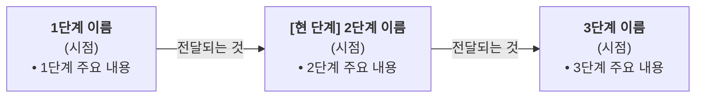

# [발표 제목]: 슬라이드 초안

<!--
사용법: 이 파일을 input/draft.md 로 복사해 채운다. 이 초안의 문구가 덱의 정본(SSOT)이다.
- 장마다 "## [Slide N] 제목" 블록 1개. 블록 안의 소제목([헤드라인] / [시각 자료: ...] / [핵심 본문 요약] / 핵심 요약)은 이름을 그대로 둔다.
- [시각 자료]는 mermaid(flowchart / sequenceDiagram / gantt), 마크다운 표, 또는 글로 쓴 배치 설명 중 하나.
- 화살표가 있는 도식은 화살표마다 "무엇이 이동하는지" 라벨을 적어 두면(예: A -->|정산 대금| B) 덱에 그대로 쓰인다.

- 수치·고유명사는 확정된 것만 쓴다. 미확정은 "(확인 필요)"라고 적는다.
  -->
- **캔버스**: `16:9` / `1440 × 810 px`
- **컬러 토큰** (선택 — 비우면 템플릿 기본색):

  - `ink`: `#171222` (제목·본문)
  - `primary`: `#4B1C87` (주 색·핵심 강조)
  - `navy`: `#2D0057` (표 머리·요약 바)
  - `accent2`: `#00939A` (보조 강조)
  - `action`: `#663B93` (보조 액센트)
  - `slate`: `#5A5470` (보조 설명)
  - `soft`: `#F3EDFB` (카드 배경)
  - `line`: `#E3DFEC` (테두리)
- **문체 원칙**: 단문 중심, 능동태, 용어 일관성, 수치 기반, ASD-STE100 규칙 적용

---

## [Slide 1] 표지 (Cover)

- 소속/보고 대상: `보고 대상 기관 또는 부서`
- 메인 제목: **발표 제목을 여기에**
- 부제: **부제 또는 보고 목적을 여기에**
- 기간·보고일: `기간 | 보고일자`
- 작성 기관: `작성 기관명`
- 표지 이미지: `assets/cover.jpg` (교체 시 파일명 유지)

---

## [Slide 2] 슬라이드 소제목을 여기에

### [헤드라인]

> **헤드라인 문장을 한 줄로 씁니다. 강조할 구간을 포함합니다.**

### [시각 자료: 단계 흐름도]

### [핵심 본문 요약]

1. **첫 번째 요점 제목**:
   - 첫 번째 요점의 본문 문장을 씁니다.
2. **두 번째 요점 제목**:
   - 두 번째 요점의 본문 문장을 씁니다.

> **핵심 요약 (Takeaway)**: 이 장에서 기억할 한 문장을 씁니다.

---

## [Slide 3] 슬라이드 소제목을 여기에

### [헤드라인]

> **표 슬라이드의 헤드라인 문장을 씁니다.**

### [시각 자료: 항목별 현황표]

| 항목             | 개수 |    진척도    | 현재 확보 범위       | 잔여 과제            |
| ---------------- | :--: | :-----------: | -------------------- | -------------------- |
| **항목 1** | N개 | **NN%** | 확보 범위를 적습니다 | 잔여 과제를 적습니다 |
| **항목 2** | N개 | **NN%** | 확보 범위를 적습니다 | 잔여 과제를 적습니다 |

### [핵심 본문 요약]

- **시사점 1**: 표에서 읽어야 할 첫 번째 포인트를 씁니다.
- **시사점 2**: 표에서 읽어야 할 두 번째 포인트를 씁니다.

> **핵심 요약 (Takeaway)**: 이 장에서 기억할 한 문장을 씁니다.
