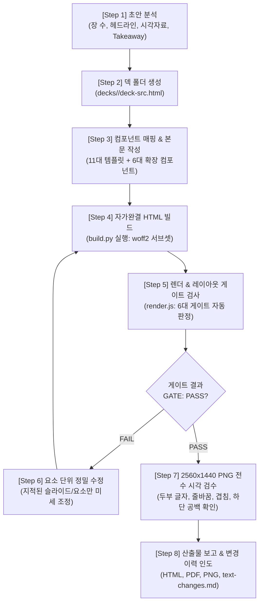

# SlideKit (slide-kit) — Production 16:9 HTML Slide Deck System

> [!IMPORTANT]
> **명시적 슬래시 명령어 전용 스킬 (Explicit Trigger Only: `/slide-kit` / `/zk-slide-kit`)**:
> 본 스킬은 사용자가 프롬프트에 `/slide-kit` 또는 `/zk-slide-kit`을 명시적으로 직접 입력했을 때만 활성화됩니다.
> 일반 발표자료, PPT/PPTX 슬라이드 제작, 마크다운 슬라이드 작성, `/yellow-design`, 또는 `/blue-design` 요청 시에는 절대로 본 스킬을 적용하지 마십시오.

`slide-kit`은 마크다운 슬라이드 초안(`draft.md`)으로부터 한국어 16:9(`1440×810`) 고정 해상도의 반응형 HTML 발표자료를 제작하고,
1) **단일 자가완결 HTML 1개**(폰트 WOFF2 서브셋 + 이미지 Base64 Data URI 완전 내장),
2) **슬라이드별 2560×1440 초고해상도 PNG**(Chrome 네이티브 렌더링),
3) **인쇄 및 배포용 통합 PDF**를 생성하며,
엄격한 **레이아웃 게이트(Layout Gate: 텍스트 넘침, 공백, 겹침, 영역 이탈 자동 판정)**를 통과할 때까지 자율 검증 및 수정을 수행하는 전문 슬라이드 엔지니어링 스킬입니다.

---

## 1. Quick Reference: 핵심 규격 및 키트 환경

| 항목 | 표준값 | 비고 / 세부 지침 |
|---|---|---|
| **화면 비율** | `16:9` 와이드스크린 | 모든 발표자료의 공통 규격 |
| **디지털 캔버스 좌표계** | `1440 × 810 px` | `.slide` 고정 크기 (패딩: `0 56px 22px`) |
| **PNG 출력 해상도** | `2560 × 1440 px` | 16:9 QHD 스케일 (`deviceScaleFactor: 2560/1440`) |
| **제목/강조 폰트** | **`Gmarket Sans`** (`DeckG`) | Bold (700), Medium (500) 내장 |
| **본문 폰트** | **`Pretendard`** (`DeckP`) | Regular (400), Medium (500), SemiBold (600), Bold (700) 내장 |
| **기본 줄바꿈 규칙** | **`word-break: keep-all`** | 한국어 어절 보존, 고유명사/수치는 `nowrap` 보호 |
| **기본 키트 경로** | `/Users/SD/Documents/Antigravity/zk-slide-kit-v0.1` | 슬라이드 템플릿, 폰트, 스크립트 모음 |
| **Rust 네이티브 빌더** | `/Users/SD/Documents/Antigravity/bin/slide_build` | 1초 이내 초고속 WOFF2 서브셋팅 및 Base64 인라인화 (Python 불필요) |
| **Rust 네이티브 렌더러/검수기** | `/Users/SD/Documents/Antigravity/bin/slide_render` | 2초 이내 6대 레이아웃 게이트 자동 판정, 2560×1440 PNG 및 통합 PDF 생성 (Node.js 불필요) |

---

## 2. Directory Structure (키트 폴더 구성)

```
zk-slide-kit-v0.1/
├── AGENTS.md                  # 슬라이드 제작 및 검수 규칙 정본
├── README.md                  # 키트 설치 및 환경 가이드
├── input/
│   ├── draft-template.md      # 초안 양식 템플릿
│   └── draft.md               # 실제 작업할 사용자 초안 (정본)
├── template/
│   ├── deck-template.html     # CSS 전체 + SVG 아이콘 스프라이트 + 11대 컴포넌트 샘플
│   └── assets/                # 기본 로고(logo.svg) 및 표지 배경(cover.jpg)
├── examples/
│   └── gyeonggi-interim/      # 실전 완성 덱 22장 (경기도 스테이블코인 도입방안 연구)
├── decks/                     # 덱 작업 디렉토리
│   └── <slug>/                # 덱 슬러그 (예: 2026-q4-report)
│       ├── deck-src.html      # 슬라이드 소스 HTML
│       ├── assets/            # 슬라이드별 이미지 및 SVG 에셋
│       ├── text-changes.md    # 초안 대비 변경 이력 기록 문서
│       └── out/               # 빌드 및 렌더 산출물 디렉토리
│           ├── <slug>.html    # (1) 단일 자가완결 HTML (폰트/이미지 내장)
│           ├── <slug>.pdf     # (2) 통합 PDF 벡터 파일
│           └── png/           # (3) 슬라이드별 2560x1440 PNG 및 gate-result.json
├── scripts/
│   ├── build.py               # 폰트 서브셋(woff2) + 이미지 Base64 인라인화
│   └── render.js              # Puppeteer 렌더링 + 6대 레이아웃 게이트 검사
└── fonts/                     # Gmarket Sans 2종 + Pretendard 4종 (수정 금지)
```

---

## 3. 8-Step Standard Workflow (제작 및 검증 8단계)

Antigravity 에이전트는 사용자의 슬라이드 제작 요청을 처리할 때 다음 8단계를 엄격히 준수합니다.



### [Step 1] 초안 접수 및 분석
- `input/draft.md` 또는 사용자가 제공한 텍스트/마크다운 문서를 정독합니다.
- 전체 슬라이드 장 수, 각 장별 `[헤드라인]`, `[시각 자료]`, 본문 항목, `[핵심 요약(Takeaway)]`, 팔레트 색상 요구사항을 분석합니다.

### [Step 2] 작업 디렉토리 생성
- 고유한 영문 슬러그(예: `decks/<slug>/`)를 정하고 기본 템플릿과 에셋을 복사합니다:
  ```bash
  mkdir -p decks/<slug>/assets
  cp template/deck-template.html decks/<slug>/deck-src.html
  cp template/assets/* decks/<slug>/assets/
  ```

### [Step 3] 컴포넌트 매핑 및 소스 작성
- 슬라이드의 기본 구조: 상단 바(`.top`) $\rightarrow$ 헤드라인(`h2.hl`) $\rightarrow$ 본문(`.bd`) $\rightarrow$ 핵심 요약 바(`.tk`). (표지 및 Q&A만 예외)
- [시각 자료]의 성격에 따라 최적의 컴포넌트 샘플을 선택하여 배치하고, 쓰지 않는 샘플 슬라이드는 삭제합니다.
- 상단 바: `PART`, 섹션명, 소제목, 쪽번호 `NN / 전체`를 장마다 정확히 부여합니다.
- `section.slide`의 `data-name` 속성에 영문 슬러그를 지정합니다 (PNG 파일명으로 사용됨).

### [Step 4] 자가완결 HTML 빌드 (`slide_build`)
- Rust 네이티브 빌더(`slide_build`)를 실행하여 폰트 서브셋팅(woff2)과 이미지 Base64 변환을 1초 이내에 수행합니다:
  ```bash
  /Users/SD/Documents/Antigravity/bin/slide_build --src decks/<slug>/deck-src.html --out decks/<slug>/out/<slug>.html
  ```
- 본문 텍스트에 사용된 모든 글자가 폰트 글리프 커버리지에 포함되었는지(`BUILD: OK`) 확인합니다.

### [Step 5] 렌더링 및 레이아웃 게이트 검사 (`slide_render`)
- **반드시 빌드된 HTML**을 렌더링합니다:
  ```bash
  /Users/SD/Documents/Antigravity/bin/slide_render decks/<slug>/out/<slug>.html decks/<slug>/out/png --pdf decks/<slug>/out/<slug>.pdf
  ```
- 6대 레이아웃 게이트(Layout Gate)가 실행되며 슬라이드별로 PASS/FAIL이 출력됩니다. (Node.js/Puppeteer 스크립트 `node scripts/render.js`도 하위 호환 유지)

### [Step 6] 레이아웃 게이트 반복 수정
- `GATE: FAIL`이 발생하면 출력된 오류 메시지와 좌표를 확인하고, **지적된 슬라이드의 해당 요소만 미세 수정**합니다.
- 덱 전체를 처음부터 다시 생성하지 않습니다 (이미 교정된 레이아웃이 유실됨).
- 수정 후 Step 4와 Step 5를 재실행하여 `GATE: PASS`가 될 때까지 반복합니다.

### [Step 7] 2560×1440 PNG 전수 시각 검수
- `decks/<slug>/out/png/` 폴더에 생성된 **모든 슬라이드 PNG를 전수 점검**합니다 (샘플링 금지).
- 점검 항목:
  - 글자가 네모(두부, tofu)로 깨진 곳이 없는가?
  - 단어 중간에서 어색하게 줄바꿈된 곳이 없는가?
  - 카드가 겹치거나 화살표 라벨이 누락된 곳이 없는가?
  - 본문 하단 1/3이 휑하게 비어있지 않은가?
  - 초안에 없는 내용이 날조되었거나, 초안의 핵심 수치가 누락되지 않았는가?

### [Step 8] 최종 보고 및 변경 이력 인도
- 결과물 경로(자가완결 HTML, PDF, PNG 폴더)와 게이트 통과 내역을 보고합니다.
- 초안 대비 수정/단축된 문구가 있을 경우 `decks/<slug>/text-changes.md`에 사유를 명시하여 함께 인도합니다.

---

## 4. 12 Golden Rules (절대 규칙 12계명)

1. **초안 문구 그대로 보존**: 헤드라인, 본문, 수치, 단위, 고유명사를 임의로 줄이거나 바꾸지 않습니다. 부득이 도식용 짧은 라벨로 변환하거나 이모지를 제거한 경우 반드시 `text-changes.md`에 "장 / 변경 전 / 변경 후 / 사유"를 기록합니다.
2. **날조 금지 (No Hallucination)**: 초안에 없는 통계 수치, 고객명, 시장 규모, 과장된 실적을 절대 지어내지 않습니다.
3. **캔버스 1440×810 고정**: `.slide`의 너비(1440px), 높이(810px), 패딩(`0 56px 22px`)을 절대 변경하지 않습니다.
4. **핵심 요약 바(`.tk`) 필수**: 표지와 Q&A 슬라이드를 제외한 모든 슬라이드 하단에 `.tk` 블록(라벨 "핵심 요약" + 초안 Takeaway 한 문장)을 반드시 배치합니다.
5. **모든 화살표에 라벨 부여**: 흐름선(`.ar`, `.va`, `.msg`)에는 "무엇이 이동/수행되는지"를 명시한 `<span>` 라벨을 100% 필수 작성합니다. 라벨 없는 빈 화살표는 금지됩니다.
6. **이모지 엄격 금지**: 슬라이드 본문에 유니코드 이모지(💡, ✔, 🚀, ⏳ 등)를 직접 삽입하지 않습니다. 반드시 SVG 인라인 스프라이트 `<svg class="ic s28"><use href="#i-아이콘명"/></svg>`를 사용합니다.
7. **하단 1/3 공백 금지 (EMPTY_BOTTOM 방지)**: 본문 콘텐츠는 본문 영역 높이의 85% 이상까지 채워져야 합니다. 비어 있을 경우 글자 크기 조정(`t18` $\rightarrow$ `t20`), 카드 높이 확장(`flex:1`, `.grow`), 세로 균등 배분(`justify-content:space-between`)으로 정돈합니다.
8. **폰트 체계 불변**: 제목/강조/라벨은 Gmarket Sans(`var(--G)`), 본문/설명은 Pretendard(`var(--P)`)만 사용합니다. 외부 웹폰트나 시스템 폰트(맑은 고딕 등)를 추가하지 않습니다.
9. **디자인 토큰 엄수**: 색상은 반드시 `:root` 블록에 정의된 CSS 변수(`var(--pri)`, `var(--navy)`, `var(--proof)` 등)만 사용합니다. 컴포넌트나 인라인 스타일에 임의의 헥사코드(`#xxxxxx`)를 직접 작성하지 않습니다.
10. **외부 리소스 호출 금지**: 외부 CDN 스크립트, 웹폰트 링크, 외부 호스팅 이미지를 절대 사용하지 않습니다. 모든 이미지는 `assets/` 상대경로를 통해 로컬에서 참조하며 `build.py`를 통해 Data URI로 자동 인라인화합니다.
11. **요소 단위 정밀 수정**: 레이아웃 게이트 실패나 수정 요청이 발생하면 지적된 슬라이드의 특정 요소만 수정합니다. 덱 전체를 처음부터 다시 생성하여 기존 수정사항을 덮어쓰지 않습니다.
12. **게이트 우회 꼼수 금지**: 게이트를 억지로 통과시키기 위해 `overflow:hidden`으로 넘침을 숨기거나, 불필요하게 `data-bleed`나 `data-overlay`를 남용하지 않습니다.

---

## 5. Color Palette & Typography Tokens (지크립토 zk-design)

`template/deck-template.html` 상단 `:root`에 선언된 공식 디자인 토큰입니다.

```css
:root {
  /* (1) 핵심 색상 (지크립토 브랜드 표준) */
  --ink: #171222;        /* 본문 및 메인 제목 텍스트 (Deep Ink) */
  --pri: #4B1C87;        /* 주 색상: 브랜드 메인, 강조 문구, 배지 (zkPrimary) */
  --navy: #2D0057;       /* 짙은 색: 표 헤더, 핵심 요약 바, 마일스톤 (zkNavy) */
  --proof: #00939A;      /* 보조 강조색: 영지식증명, 검증, 청록 액센트 (zkProof) */
  --act: #663B93;        /* 보조 액센트: 승인, 진행 상태 (zkAction) */
  --slate: #5A5470;      /* 보조 설명문, 서브 텍스트, 보조 화살표 (zkSlate) */
  --muted: #8A8499;      /* 각주, 흐린 텍스트, 비활성 라벨 (zkMuted) */
  --line: #E3DFEC;       /* 테두리선, 구분선, 기본 경계 (zkLine) */
  --soft: #F3EDFB;       /* 주 색상 연한 틴트 배경 (zkSoft) */
  --proofsoft: #E6F5F5;  /* 보조 강조색 연한 틴트 배경 */
  --ok: #1E9E5A;         /* 정상, 통과, 완료 상태 (Green) */
  --bad: #D23F3F;        /* 경고, 실패, 결함 상태 (Red) */

  /* (2) 폰트 패밀리 스택 */
  --G: 'DeckG', 'DeckP'; /* 제목, 강조 헤더, 배지, 숫자 (Gmarket Sans) */
  --P: 'DeckP';          /* 본문, 설명, 표 내용, 테이크어웨이 (Pretendard) */
}
```

---

## 6. Slide Component Catalog (컴포넌트 카탈로그)

### A. 기본 11대 컴포넌트 (`template/deck-template.html`)

1. **`cover` (표지)**:
   - 좌측 대형 타이틀, 프로젝트 부제, 우측 비주얼 컷아웃/배경 이미지(`cover.jpg`), 하단 발표자/소속 메타.
2. **`flow-steps` (단계별 흐름도)**:
   - 좌에서 우로 진행되는 3~5단계 프로세스 카드와 라벨 화살표(`.ar`).
3. **`table-bars` (표 + 진척 바)**:
   - 구조화된 비교 데이터 표와 상태별 프로그레스 바(비율, 퍼센트, 진행도).
4. **`asis-tobe-flow` (AS-IS vs TO-BE 대조 흐름)**:
   - 상단 기존 문제점(AS-IS, `--bad`)과 하단 개선 모델(TO-BE, `--pri`/`--proof`) 대조.
5. **`option-cards` (대안 비교 카드)**:
   - 2~4개의 대안(Option A, B, C)을 나란히 배치하고 추천 대안에 하이라이트 테두리(`.card.hi`).
6. **`layer-stack` (계층형 아키텍처 스택)**:
   - 상하 수직으로 쌓이는 플랫폼/인프라/애플리케이션 계층 구조도.
7. **`sequence` (시퀀스 상호작용 다이어그램)**:
   - 참여자(Client, Server, Verifier 등) 간 메시지 왕복 흐름(`.msg`).
8. **`comparison-table` (정밀 비교 매트릭스)**:
   - 다차원 평가 기준별 O/X/△ 기호 및 상세 스펙 비교 표.
9. **`gantt` (추진 일정 및 간트 차트)**:
   - 주차/월별 마일스톤 및 병렬 실행 로드맵.
10. **`decisions` (의사결정 및 쟁점 도출)**:
    - 핵심 질문, 선택지별 기대효과 및 리스크, 최종 권고안 박스.
11. **`qna` (질의응답 및 클로징)**:
    - 발표 마무리 및 담당자 연락처, 공식 채널 안내.

### B. 확장 실전 컴포넌트 (`examples/gyeonggi-interim/deck-src.html`)
템플릿에 없는 특수 도해는 실제 경기도 스테이블코인 22장 덱에서 추출하여 활용합니다:
- **`merge-flow` (병합 도식)**: 다수의 소스가 하나로 수렴하거나 분기되는 파이프라인.
- **`donut-gauge` (도넛 게이지)**: 원형 지표 달성도 및 비율 시각화.
- **`wireframe-box` (UI 와이어프레임)**: 모바일 앱 지갑이나 관리자 화면 레이아웃 축약도.
- **`hub-2x2` (2×2 사분면 허브)**: 4가지 전략 축을 중심으로 연결되는 중앙 허브 다이어그램.
- **`ok-bad-rows` (정상/실패 행)**: 올바른 처리 경로와 예외/실패 경로의 병렬 대조.

---

## 7. Layout Gate Error Diagnostics (게이트 에러 진단 및 해결)

`render.js` 실행 시 레이아웃 게이트가 실패하면 아래 조치법을 즉시 적용합니다.

| 게이트 오류 코드 | 원인 및 현상 | 해결 지침 |
|---|---|---|
| **`TEXT_OVERFLOW`** | 텍스트 내용이 컨테이너 박스 경계를 넘침 | 박스 너비(`width`/`flex`)를 늘리거나, 글자 크기를 1단계 축소(`t20` $\rightarrow$ `t19`), 여백(`padding`/`gap`) 축소. (문구 삭제는 원칙적 금지) |
| **`OUT_OF_SLIDE`** | 요소가 1440×810 캔버스 밖으로 이탈 | 좌우/상하 위치 재조정, 마진 축소, 부모 컨테이너 크기 점검. 의도적 배경 확장의 경우에만 `data-bleed` 속성 부여 |
| **`OUT_OF_BODY`** | 본문 요소가 헤드라인(`.hl`) 또는 테이크어웨이(`.tk`) 침범 | 본문 블록 세로 높이 축소, `gap` 조정, 글자 크기 축소 |
| **`BIG_GAP`** | 본문 블록 간 수직 간격이 44px을 초과하여 공백 발생 | 카드나 컨테이너에 `.grow` 또는 `flex:1`을 부여하여 공간을 채우거나 균등 분배 |
| **`EMPTY_BOTTOM`** | 본문 콘텐츠가 본문 높이의 85% 지점 이전에 끝남 | 글자 크기 확대(`t18` $\rightarrow$ `t20`), 카드 패딩 확대, `justify-content: space-between` 적용 |
| **`OVERLAP`** | 카드나 노드 요소가 비의도적으로 겹침 | `flex-direction` 또는 `gap` 재설정. 의도적인 시각 레이어 겹침일 경우 해당 요소에 `data-overlay` 선언 |
| **`FONTS: NOT LOADED`** | 폰트가 로드되지 않거나 네모(tofu) 발생 | `deck-src.html`이 아니라 **빌드된 HTML**을 렌더링했는지 확인, `fonts/` 폴더의 OTF/TTF 파일명 매칭 확인 |
| **`EXTERNAL REQUESTS`** | 외부 CDN 또는 이미지 링크가 포함됨 | 외부 링크를 제거하고 로컬 `assets/` 상대경로로 변경 후 재빌드 |

---

## 8. CLI Command Cheat Sheet (명령어 요약)

```bash
# 기본 키트 디렉토리로 이동
cd /Users/SD/Documents/Antigravity/zk-slide-kit-v0.1

# (1) 새 덱 준비 (slug 예: q4-strategy)
mkdir -p decks/q4-strategy/assets
cp template/deck-template.html decks/q4-strategy/deck-src.html
cp template/assets/* decks/q4-strategy/assets/

# (2) 빌드: WOFF2 서브셋팅 + 이미지 인라인화 (Rust 네이티브 빌더, 단일 HTML 생성)
/Users/SD/Documents/Antigravity/bin/slide_build --src decks/q4-strategy/deck-src.html --out decks/q4-strategy/out/q4-strategy.html

# (3) 렌더링 & 게이트: 2560x1440 PNG 및 PDF 출력 + 레이아웃 게이트 검사 (Rust 네이티브 렌더러)
/Users/SD/Documents/Antigravity/bin/slide_render decks/q4-strategy/out/q4-strategy.html decks/q4-strategy/out/png --pdf decks/q4-strategy/out/q4-strategy.pdf

# 특정 슬라이드만 빠르게 재렌더링할 때 (--only)
/Users/SD/Documents/Antigravity/bin/slide_render decks/q4-strategy/out/q4-strategy.html decks/q4-strategy/out/png --only 3,4

# (4) 결과물 확인 (Mac)
open decks/q4-strategy/out/png decks/q4-strategy/out/q4-strategy.pdf
```

---

## 9. Final Response Format (보고 형식)

덱 제작 및 검수 완료 후 사용자에게 다음 형식으로 최종 인도합니다:

```markdown
### 🎯 SlideKit 덱 제작 및 검수 보고

- **산출물 경로**:
  - 자가완결 HTML: `decks/<slug>/out/<slug>.html`
  - 고해상도 PNG (2560×1440): `decks/<slug>/out/png/` (총 N장)
  - 통합 벡터 PDF: `decks/<slug>/out/<slug>.pdf`
  - 변경 이력 문서: `decks/<slug>/text-changes.md`
- **레이아웃 게이트 결과**: `GATE: PASS` (총 N장 전원 통과)
- **전수 시각 검수 내역**: N장 전수 확인 완료
  - 글자 깨짐(두부 현상): 없음 (글리프 100% 서브셋 완료)
  - 줄바꿈 및 어절: `keep-all` 정상 적용
  - 하단 공백: 85% 이상 알차게 충진 완료
- **초안 대비 변경 사항**: `text-changes.md` 요약 (없으면 "초안 문구 100% 일치")
```
